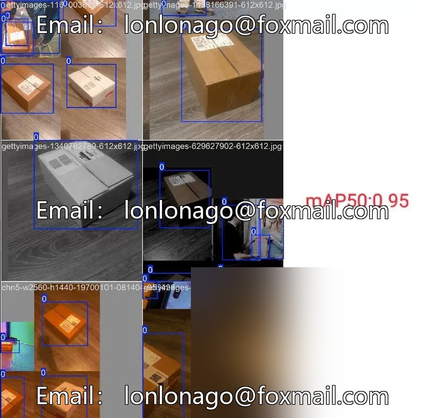
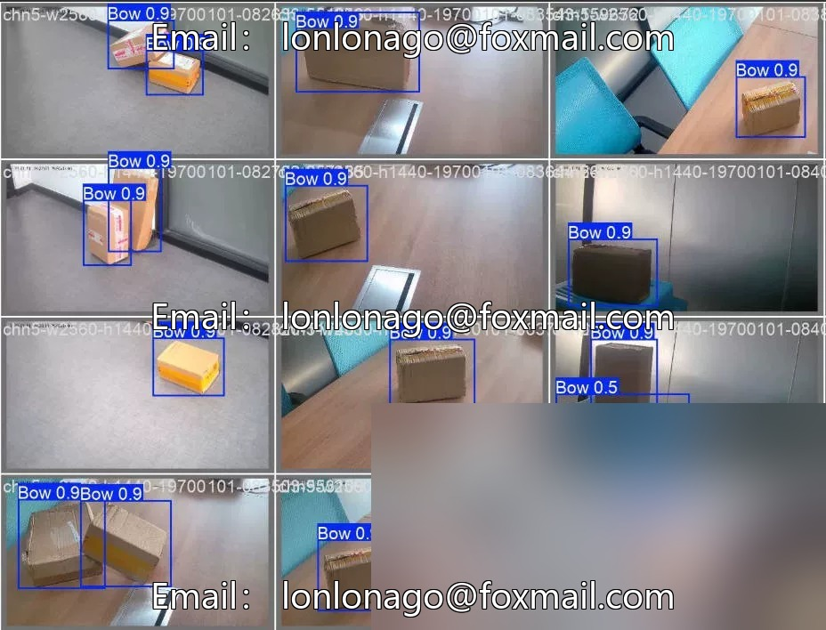
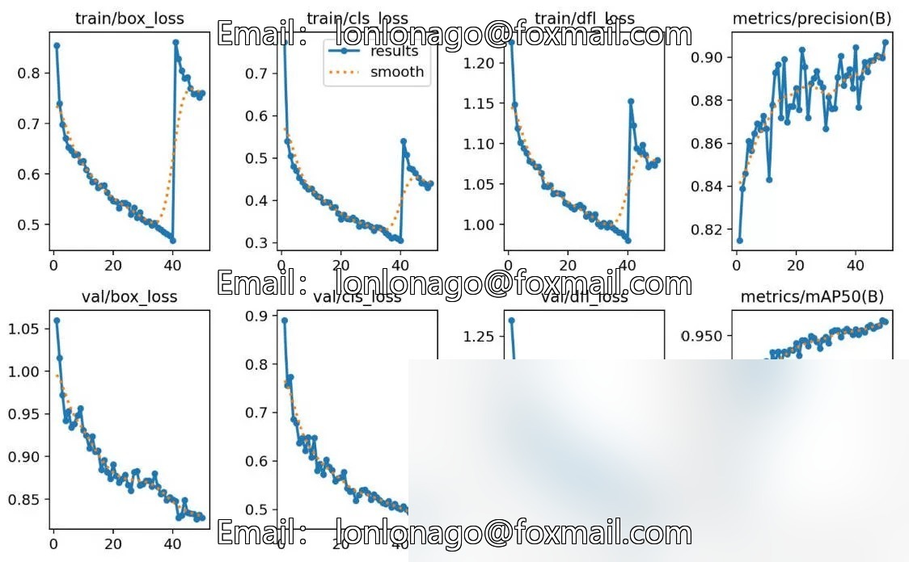
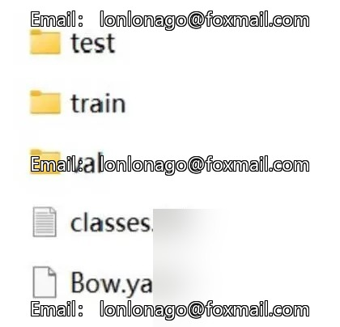
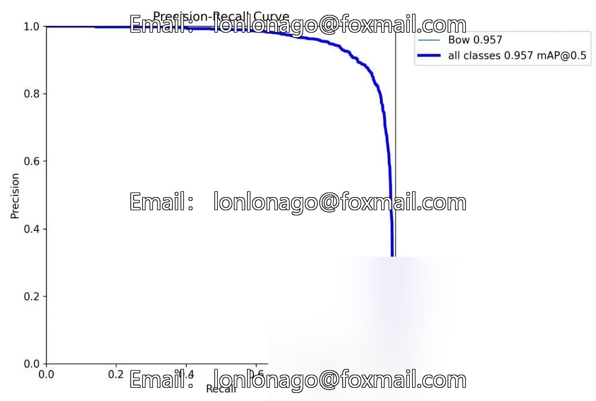

# Express package carton dataset, 1 class YOLO format, intelligent logistics specific

## Body

Express delivery box dataset, 1 category YOLO format, specialized for intelligent logistics

A total of 2,664 images (training set 1,864, validation set 532, test set 268)
Industrial-grade annotation standards, YOLO format simultaneous support
Compatible with mainstream versions such as YOLOv5/v8/v11

Dataset specifications:
1. Annotation format: txt (YOLO format)
2. Category labels: 0: Box (express box detection, 7096 boxes)

Data source: collected from real logistics scenarios

web-based shipment, can be directly photographed and shipped.

The dataset is for smart logistics with YOLO format txt annotation, including Box detection for express boxes; industrial-grade annotation standards and compatibility with mainstream versions such as YOLOv5, v8 and v11 are provided.

<!-- AI_ENRICHED -->

## Images

## Payment

Here is a pay link on Stripe ( https://buy.stripe.com/3cs8yP7sY87d0vu9AB ). Please contact me lonlonago@foxmail.com after funding $89, and I will send you a complete data files , thank you!

